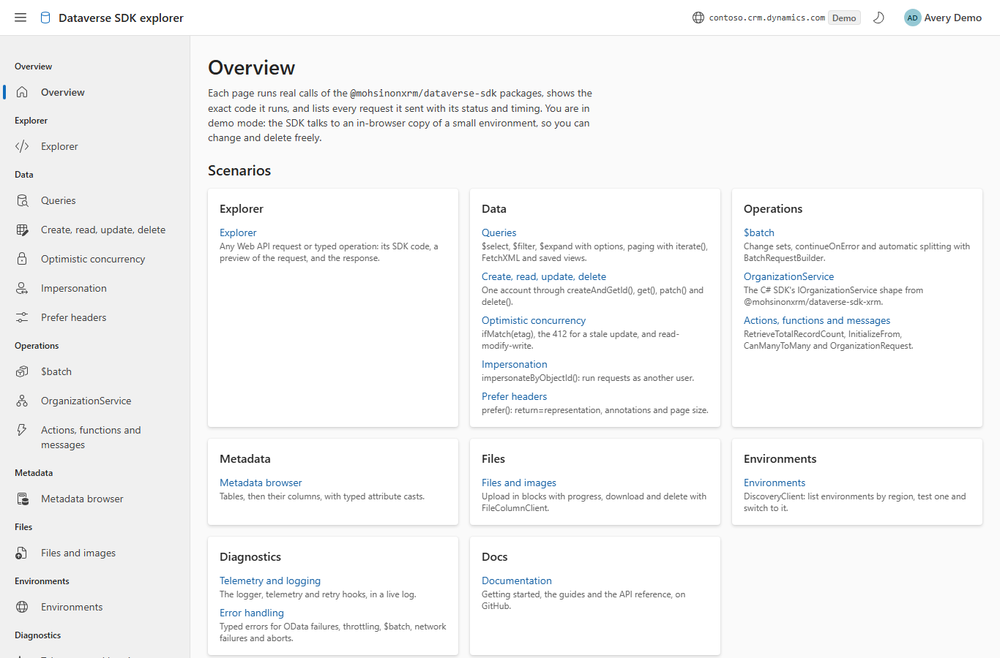
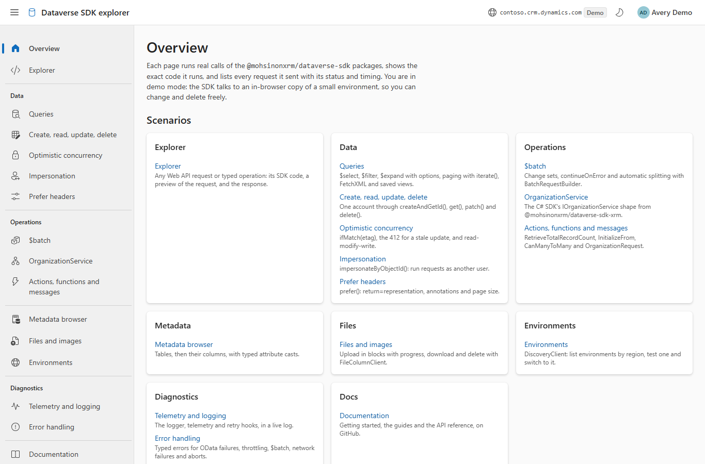
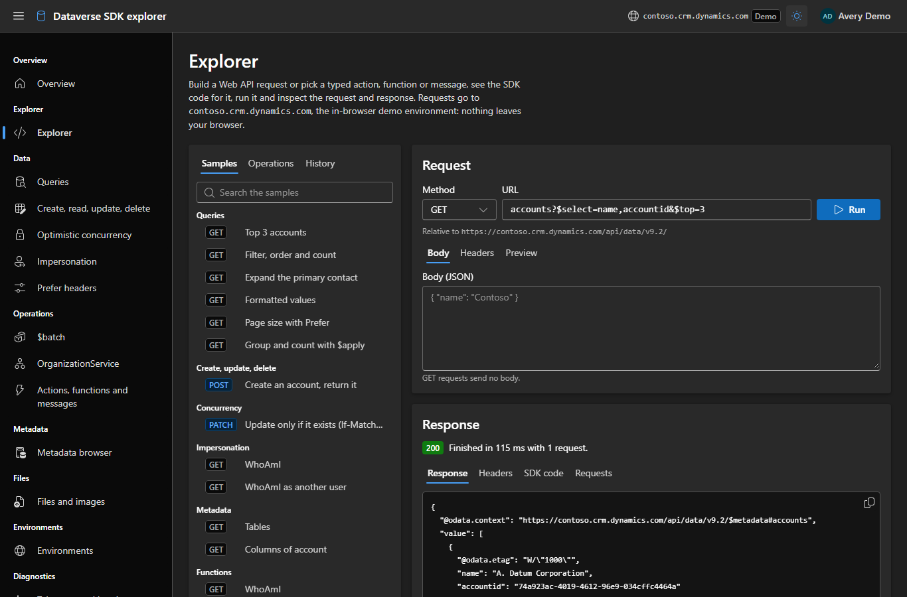
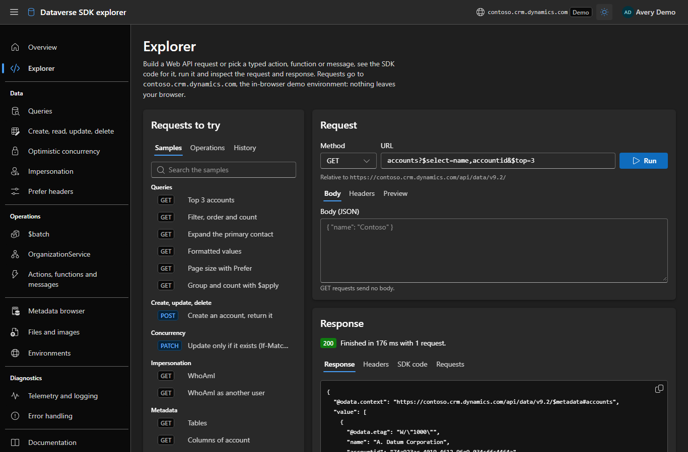
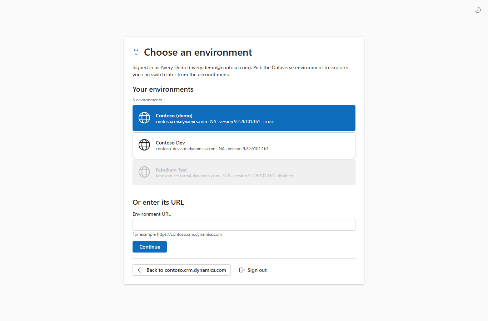
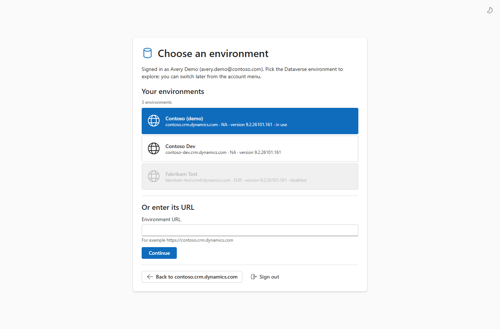
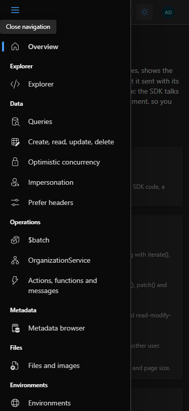
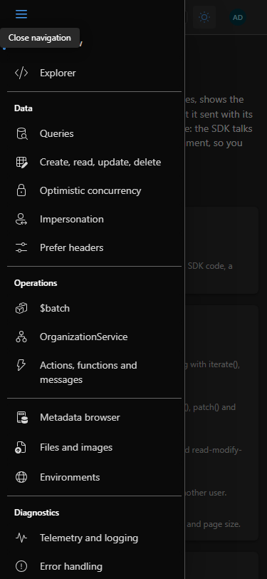
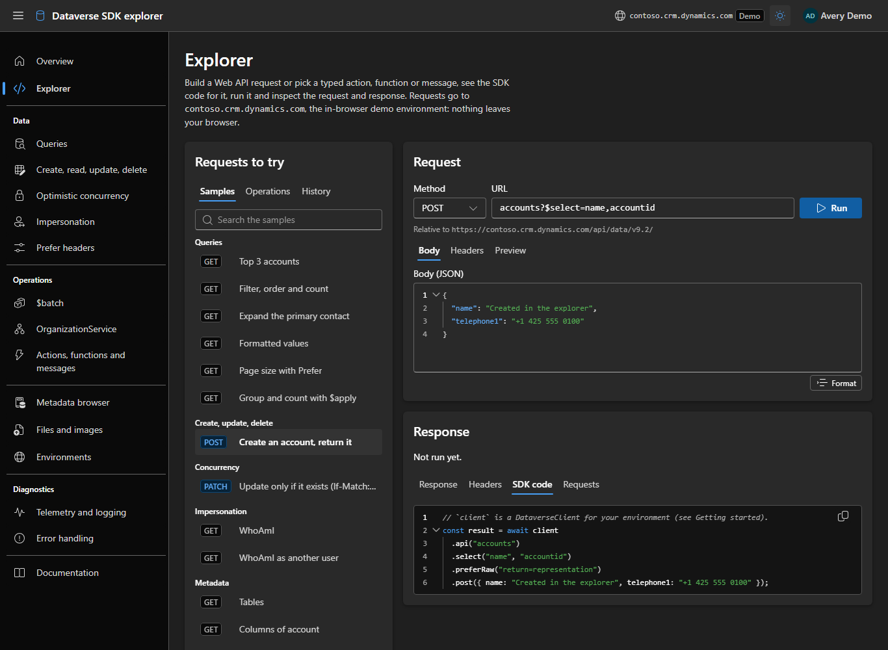
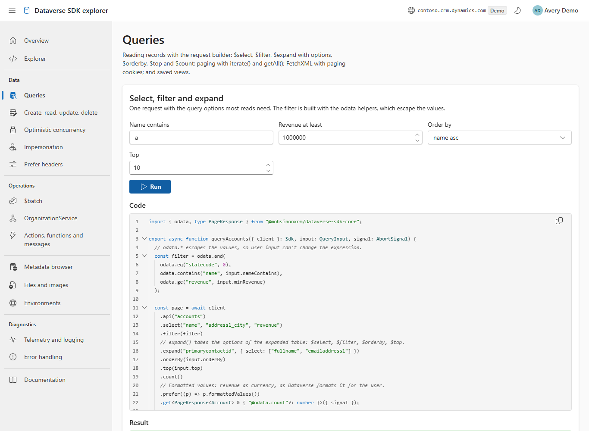

# Fluent 2 design review

A review of the explorer site (this sample, live at https://dataverse-sdk.mohsinonxrm.com)
against the [Fluent 2 guidelines](https://fluent2.microsoft.design) and the
[Fluent UI React v9](https://react.fluentui.dev) components, for
[#473](https://github.com/mohsinonxrm/dataverse-sdk-typescript/issues/473). The app already used
only `@fluentui/react-components` v9 and `@fluentui/react-icons`, theme tokens for colour, and
v9 components for navigation (`NavDrawer`), data (`DataGrid`, `Table`), forms (`Field`,
`Dropdown`, `SpinButton`) and feedback (`MessageBar`, `Toast`, `Skeleton`, `Spinner`), so the
findings are refinements rather than replacements.

Each finding: **where**, what was off, the Fluent 2 guidance, and the fix. `[x]` is fixed in the
pull request for #473; `[ ]` is deferred, with the reason.

## Layout and spacing

- [x] **Breakpoints repeated as literals** — `AppShell.tsx`, `AppHeader.tsx`, `SignInPage.tsx`,
      `EnvironmentPicker.tsx`, `ExplorerPage.tsx`, `hooks/useMediaQuery.ts` each wrote
      `(max-width: 47.99em)` or `(max-width: 63.99em)`. Fluent 2's
      [layout](https://fluent2.microsoft.design/layout) defines window size classes, and Fluent
      has no breakpoint tokens. Fix: `src/theme/layout.ts` names the two breakpoints (768px and
      1024px) and the content widths once, and every file uses them.
- [x] **Horizontal spacing tokens on the vertical axis** — `Scenario.tsx` (fields grid),
      `ParameterForm.tsx`, `HomePage.tsx`, `DocsPage.tsx`, `ExplorerPage.tsx` used
      `gap: spacingHorizontalM/L` for two-dimensional grids, and the cards
      `padding: spacingHorizontalL` on all sides. Fluent's
      [spacing ramp](https://fluent2.microsoft.design/layout#spacing) has vertical and
      horizontal tokens. Fix: `rowGap` with a vertical token and `columnGap` with a horizontal one.
- [x] **Cards padded by hand** — every page `Card` overrode `padding` (and some `gap`). v9 `Card`
      has `size` (small 8px, medium 12px, large 16px) that sets padding, gap and the matching
      corner radius together. Fix: `size="large"` on the page cards, with no padding overrides;
      they now get `borderRadiusLarge`, as Fluent 2 gives large cards. The sign-in and
      environment cards keep a wider inset on wide screens, now written with vertical and
      horizontal tokens.
- [x] **Bare text in results** — `CrudPage.tsx` (new id), `FilesPage.tsx` (record, upload) and
      `OperationsPage.tsx` (version) rendered text outside any typography component. Fix: `Body1`.

## Navigation

- [x] **Section header for one item** — `AppNav.tsx` gave every group a `NavSectionHeader`, so
      six groups showed a header over one item with nearly the same name ("Overview / Overview",
      "Docs / Documentation"). Fluent 2 [nav](https://fluent2.microsoft.design/components/web/react/core/nav/usage)
      uses section headers to group several items. Fix: groups of one item have no header (and no
      `role="group"`); `NavDivider`s set the sections apart, and pages on their own run together.
- [x] **No selected icon state** — `routes.ts` used regular icons only. Fluent 2 nav shows the
      filled icon on the selected item (and on hover), which `NavItem` does when the icon is a
      `bundleIcon(Filled, Regular)`. Fix: the route icons are bundled.
- [x] Responsive drawer — already `NavDrawer` inline at 1024px and wider, an overlay with a
      `Hamburger` below, closing after a choice. Kept.

## Typography

- [x] **Headings with `Text` instead of the type ramp** — `Scenario.tsx` (Code / Result /
      Requests: `Text as="h3" weight="semibold"`), `OperationPicker.tsx` (sample groups),
      `RequestInspector.tsx` (URL / Error / headers labels), `AppHeader.tsx` (app name). Fluent 2
      [typography](https://fluent2.microsoft.design/typography) uses the ramp's named styles. Fix:
      `Subtitle2` for scenario sections, `Caption1Strong` for small labels and group headers,
      `Subtitle2` for the app name.
- [x] **Raw `<code>`** — `HomePage.tsx` used `<code>`, which takes the browser's monospace font,
      not `fontFamilyMonospace`. Fix: the shared `mono` style.

## Iconography

- [x] **Sized and unsized icons mixed inside components** — `SignOut20Regular` in the account
      menu but `SignOutRegular` in the picker; `ArrowSwap20Regular` / `ArrowSwapRegular`;
      `Globe20Regular` / `GlobeRegular`; `DocumentArrowUp20Regular` in a `Button`. Fluent v9
      components size their icon slot to the control, so icons in `Button`, `MenuItem`,
      `CompoundButton` and `NavItem` should be the unsized ones. Fix: unsized icons inside
      components; sized icons only standalone (the brand mark).
- [x] **Brand icon smaller than its heading** — `SignInPage.tsx`, `EnvironmentPicker.tsx`: a
      20px icon next to a `Title2` (28px type on a 36px line). Fluent 2 pairs icon size with the
      text it sits with. Fix: `Database32Regular` (the icon set has no 28px database icon).
- [x] **Theme toggle written three times** — `AppHeader.tsx`, `SignInPage.tsx`,
      `EnvironmentPicker.tsx`. Fix: one `ThemeToggle` component.

## Data display

- [x] **Grids always wider than a phone** — `RecordsGrid.tsx` gave every grid
      `min-width: 36rem`, so a two-column result scrolled sideways at 375px. Fix: the minimum
      width follows the number of columns (none up to two, 24rem for three, 36rem for more).
- [x] **Action columns without a header** — `MetadataPage.tsx` ("Browse columns") and
      `DiscoveryPage.tsx` ("Use") had an empty column header. Fluent's `DataGrid` examples name
      every column. Fix: the header says "Action".
- [x] **Explorer picker lists as `<ul>` of buttons** — `OperationPicker.tsx`. v9 has `List` /
      `ListItem` with arrow-key navigation. Deferred from #473, done in
      [#472](https://github.com/mohsinonxrm/dataverse-sdk-typescript/issues/472): each list
      (a sample group, the operations found, the history) is a v9 `List` with
      `navigationMode="items"` and single selection, so it is one Tab stop: the arrow keys move
      between its items, Enter, Space or a click chooses one, and Tab goes on to the next list.
      It is a listbox whose selected option is the request shown, and it keeps working while the
      search filters it (the selection follows the item, not its position).

## Feedback: loading, empty and error states

- [x] **Environment list loads with a spinner** — `EnvironmentPicker.tsx`. Fluent 2 uses
      [skeletons](https://fluent2.microsoft.design/components/web/react/core/skeleton/usage)
      when the shape of the content is known. Fix: a `Skeleton` of three rows shaped like the
      environment buttons.
- [x] Scenario results already have idle text, a `Skeleton` while running, a success
      `MessageBar`, and an `ErrorCard` (`MessageBar` intent error/warning) by error class.
      Copy and run results use `Toast`. Kept.

## Accessibility

- [x] **Button inside a link** — `AppShell.tsx` "Page not found": `<Link><Button/></Link>` is
      nested interactive content (one control announced twice, two tab stops). Fix: one
      `Button` that navigates.
- [x] **Heading level skipped in the explorer** — `ExplorerPage.tsx`: the picker card had no
      heading, so the sample groups (`h3`) came straight after the page's `h1`. Fix: a
      `Subtitle1` `h2` "Requests to try", like the Request and Response cards.
- [x] **Tab panel not tied to its tab** — `OperationPicker.tsx`: `role="tabpanel"` named with
      `aria-label`. Fix: `aria-labelledby` the selected tab, as the ARIA tabs pattern has it.
- [x] **Identical landmark names** — `Scenario.tsx`: every scenario had regions named "Code",
      "Result" and "Requests", so a page had many landmarks with the same name. Fix: each
      section is labelled by the scenario title and its heading ("Create Result").
- [x] **Focus indicator on scrollable regions** — `CodeBlock.tsx` drew its own outline on
      `:focus-visible`; the Telemetry log (`role="log"`, `tabIndex=0`) had only the browser's.
      Fix: both use `createFocusOutlineStyle()`, Fluent's keyboard-only focus outline.
- [x] **Explorer request/response panels are sections, not tab panels** — `ExplorerPage.tsx`:
      the content under the Request and Response tab lists was a named `section`. Deferred from
      #473, done in #472: each tab list has one `role="tabpanel"` labelled by the selected tab
      (`aria-labelledby`), and every tab `aria-controls` it (`components/tabs.ts`, which the
      picker uses too). The panels' code and JSON are Monaco editors, each with its own
      accessible name.
- [x] Skip link, focus moved to `<main>` after navigating, landmarks (`banner`, `navigation`,
      `main`), labelled form controls and axe WCAG 2.1 A/AA — already in place and covered by the
      e2e tests. Kept.
- [x] **High contrast** — checked with forced colours: the components map to system colours;
      the custom borders and code colours fall back to `CanvasText`/`ButtonBorder`. No change
      needed.
- [x] **Reduced motion** — the only animations are Fluent's (drawer, dialog, skeleton, toast),
      which honour `prefers-reduced-motion`. No custom motion. No change needed.

## Theme

- [x] Light and dark: `webLightTheme` / `webDarkTheme` with every colour from tokens, the page
      background following the theme. Parity checked page by page in both. Kept.
- [ ] **System theme changes while the app is open** — the first visit follows
      `prefers-color-scheme`, later ones the saved choice; a change of the system theme is
      picked up on the next visit. Deferred: small, and a three-way (light / dark / system)
      control is a design change of its own.

## Screenshots

Demo mode, at 1366px and 375px wide. The full set (every main page, light and dark, desktop and
375px, and forced colours) was compared page by page; these four pairs show the visible changes.

| Before                                                                                | After                                                                                 |
| ------------------------------------------------------------------------------------- | ------------------------------------------------------------------------------------- |
|            |              |
| Navigation: a section header over every single page; regular icons only.              | Headers only over groups, dividers between sections, the selected page's icon filled. |
|              |                |
| The picker card has no heading.                                                       | "Requests to try" heading, like Request and Response; large cards.                    |
|    |      |
| A 20px brand icon next to the page title.                                             | The icon matches the title; large card radius.                                        |
|  |    |
| The overlay drawer at 375px, with the repeated headers.                               | The same drawer, shorter, with sections set apart.                                    |

## Code editor (#472)

The explorer and the scenario pages after
[#472](https://github.com/mohsinonxrm/dataverse-sdk-typescript/issues/472): code and JSON in the
Monaco editor with Fluent-derived themes, the request body as a JSON field with **Format**, and
the picker's v9 `List` with the chosen sample selected (compare the explorer with the "after"
above).

| Explorer, dark                                                              | Queries, light                                                                 |
| --------------------------------------------------------------------------- | ------------------------------------------------------------------------------ |
|  |  |
